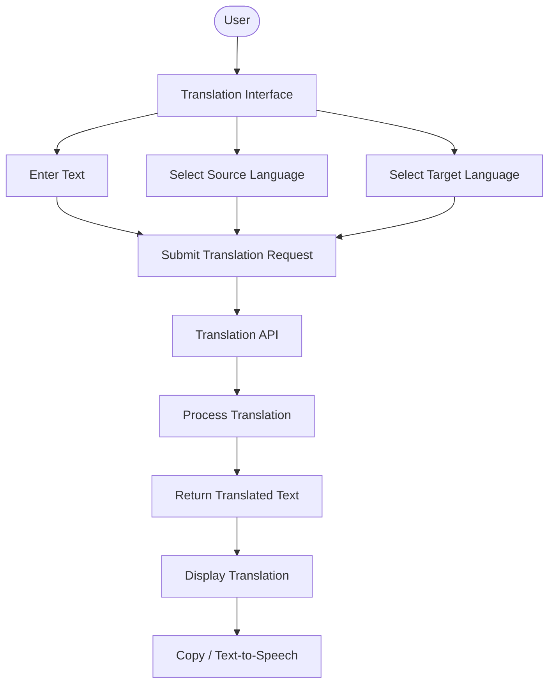
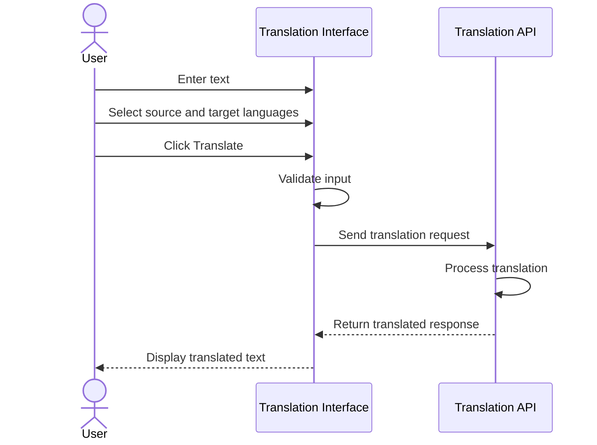

# 🌍 Language Translation Tool

A simple, interactive, and user-friendly **Language Translation Tool** that allows users to translate text from one language to another using a translation API. The application provides an intuitive interface where users can enter text, select source and target languages, and instantly view the translated output.

Built to make multilingual communication easier, this project demonstrates the integration of frontend interfaces with external translation services and API-based data processing.

---

## 📌 Project Overview

The Language Translation Tool enables users to translate text between multiple languages through a clean and accessible interface.

Users can enter text, choose the source and destination languages, and submit their input for translation. The application communicates with a translation API, processes the request, and displays the translated result.

### 🎯 Objectives

- Build an intuitive interface for text translation.
- Support multiple source and target languages.
- Integrate an external translation API.
- Process user input and retrieve translated responses.
- Display translated text clearly and efficiently.
- Improve usability with additional features such as copy-to-clipboard and text-to-speech.

---

## ✨ Features

| Feature | Description |
|---|---|
| 🌐 Multi-language Support | Translate text between supported languages. |
| 📝 Text Input | Enter custom text for translation. |
| 🔄 Language Selection | Select source and target languages. |
| ⚡ API Integration | Connect with an external translation service. |
| 📄 Translation Output | Display translated text in a dedicated output area. |
| 📋 Copy Translation | Copy translated text to the clipboard (if implemented). |
| 🔊 Text-to-Speech | Listen to translated text (if implemented). |
| 🎨 User-friendly UI | Simple and intuitive interface. |

---

## 🏗️ System Architecture

The application follows a client-side interface and external API integration architecture.



### Architecture Components

1. **User Interface:** Accepts text and language preferences.
2. **Input Processing:** Collects and validates the user's input.
3. **API Integration:** Sends the translation request to the external service.
4. **Translation Engine:** Processes the text and generates the translated result.
5. **Output Display:** Presents the translated text to the user.
6. **Additional Utilities:** Provides optional copy and speech functionalities.

---

## 🔄 Application Workflow



---

## 🛠️ Technology Stack

| Technology | Purpose |
|---|---|
| HTML | Structure of the application |
| CSS | Styling and responsive layout |
| JavaScript | Application logic and user interactions |
| Translation API | Text translation service |
| Fetch API | Communicating with the translation service |

### Possible Translation Service Providers

- Google Cloud Translation API
- Microsoft Translator API

*Mention only the API provider and technologies actually used in your implementation.*

---

## 📂 Project Structure

```text
Language-Translation-Tool/
│
├── index.html          # Main application interface
├── style.css           # Application styling
├── script.js           # Translation logic and API integration
│
├── assets/             # Images and other static resources
│
└── README.md           # Project documentation
```

---

## ⚙️ Installation & Setup

Follow these steps to run the project locally.

### 1. Clone the Repository

```bash
git clone https://github.com/Avinash-K18/Language-Translation-Tool.git
```

### 2. Navigate to the Project Directory

```bash
cd Language-Translation-Tool
```

### 3. Configure API Credentials

If your translation provider requires an API key, configure it according to the provider's documentation.

**Security Note:** Never expose private API credentials in publicly accessible frontend JavaScript. Use a backend proxy or secure environment configuration.

### 4. Run the Application

Open `index.html` in your browser or use the VS Code Live Server extension.

---

## 🔐 API Integration

The application uses an external translation API to convert the input text into the selected target language.

### Translation Request Flow

1. Collect the input text.
2. Retrieve the selected source language.
3. Retrieve the selected target language.
4. Send the request to the translation API.
5. Receive the translated response.
6. Extract and display the translated text.

The translation API handles the actual language conversion, while the application manages user interaction and response presentation.

---


## 🚀 Future Enhancements

Potential improvements for future versions include:

- Automatic source-language detection.
- Voice input using speech recognition.
- Text-to-speech for translated content.
- Language swapping functionality.
- Translation history.
- Support for document translation.
- Improved mobile responsiveness.
- Dark mode.
- Backend integration for secure API management.

---

## 🎓 Learning Outcomes

Through this project, the following concepts can be explored:

- Frontend development and UI design.
- Working with REST APIs.
- Asynchronous JavaScript and Fetch API.
- JSON request and response handling.
- Error handling and input validation.
- Integration of third-party services.
- Building interactive web applications.

---

## 👨‍💻 Author

**Avinash Kumar**

GitHub: [@Avinash-K18](https://github.com/Avinash-K18)

---

## ⭐ Support

If you find this project useful, consider giving the repository a ⭐ on GitHub!

**Project:** Language Translation Tool  
**Category:** Web Development / API Integration  
**Task:** CodeAlpha Internship – Task 1
